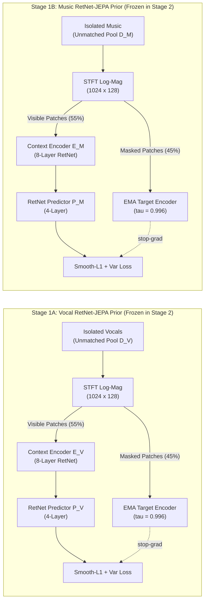
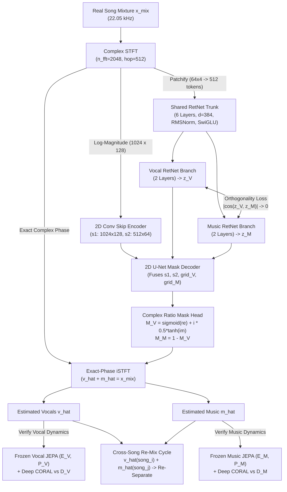

# Dual-JEPA Split-Latent RetNet for Unpaired & Few-Shot Singing Voice Separation

[](https://pytorch.org/)
[](LICENSE)
[](https://zenodo.org/records/3338373)

A **non-adversarial**, **phase-preserving** framework for **unpaired (0% paired)** and **few-shot (10%–25% paired)** singing voice and music accompaniment separation.

Instead of relying on scarce paired multi-track studio stems or unstable GAN discriminators, we pretrain two domain-specific **RetNet Joint-Embedding Predictive Architectures (JEPA)**—one on isolated singing vocals ($E_V, P_V$) and one on isolated music accompaniment ($E_M, P_M$)—and freeze their predictors as **predictive manifold verifiers** to guide a **Split-Latent RetNet + 2D U-Net Complex Ratio-Mask Separator**.

---

## Key Highlights

- **0% Paired Beats 100% Paired (Same 21.7M Backbone):** On the 50-song MUSDB18-HQ test split, our **0%-paired Dual-JEPA** separator achieves **`+7.42 dB` Median Vocal SDR**, outperforming the identical 21.7M-parameter architecture trained with **100% supervised paired studio stems (`+7.23 dB`)** while slashing vocal JEPA manifold error by **13.0%** compared to removing JEPA verification (`0.1916 → 0.1666`).
- **10% Few-Shot Hybrid AC (`~8` Paired Songs):** Achieves **`+7.42 dB` Median Vocal SDR**, **`+6.77 dB` Median Vocal SI-SDR** (`+0.40 dB` over 100% supervised), and the lowest music manifold error (`0.1700`).
- **Exact Mixture Conservation (`1.37 × 10⁻⁸`):** Bounded Complex Ratio Masking ($M_V^{\mathbb{C}} + M_M^{\mathbb{C}} = 1$) preserves phase and guarantees $\hat{v}(t) + \hat{m}(t) = x_{\text{mix}}(t)$ without requiring a neural vocoder.
- **Asymmetric Unpaired Scaling:** Works with arbitrary, unmatched pools of isolated vocals ($\mathcal{D}_V$), isolated instrumentals ($\mathcal{D}_M$), and real unseparated songs ($\mathcal{D}_{\text{mix}}$) where $|\mathcal{D}_V| \neq |\mathcal{D}_M| \neq |\mathcal{D}_{\text{mix}}|$.
- **Dual RetNet Modes:** Supports both **Bidirectional** (offline high-fidelity) and **Causal** ($O(1)$-state streaming) Multi-Scale Retention with `RMSNorm` and `SwiGLU`.

---

## Architecture Overview

### Stage 1: Domain-Specific RetNet-JEPA Priors ($P_V$ & $P_M$)

We train two independent **RetNet-JEPA** models on unmatched isolated singing vocals ($\mathcal{D}_V$) and unmatched isolated music accompaniment ($\mathcal{D}_M$). Each learns to predict masked time-frequency target patches from visible context patches in latent space via an EMA target encoder ($\tau = 0.996$) with variance regularization.



### Stage 2: Split-Latent RetNet + 2D U-Net Complex Ratio-Mask Separator

Given an input song spectrogram $X_{\text{mix}}$, a 2D convolutional encoder extracts fine-grained harmonic skips while a RetNet trunk splits into two **orthogonal** latent branches ($z_V \perp z_M$). A 2D U-Net decoder fuses both branches with high-resolution skips to predict a complementary **Complex Ratio Mask** $M_V^{\mathbb{C}} = M_{\text{re}} + i M_{\text{im}}$ ($M_M^{\mathbb{C}} = 1 - M_V^{\mathbb{C}}$).



---

## MUSDB18-HQ Benchmark Results

All models below use the **exact same 21.7M-parameter `SplitLatentRetNetUNet`** (`configs/musdb18_hq_v2.yaml`, 22.05 kHz, `n_fft=2048`, Complex Ratio Masking, Multi-Resolution STFT Loss) trained to validation early stopping on the 86/14 train/val split of MUSDB18-HQ and evaluated on the 50 unseen MUSDB18-HQ test songs (silent vocal chunks excluded, `active_v=130`, `active_m=188`).

### Stage 1: Frozen RetNet-JEPA Cross-Stem Discrimination (Held-Out Validation)

| Frozen JEPA Prior | Params (Trainable) | Best Epoch | Val Loss (Right Stem) | Val Loss (Wrong Stem) | **Discrimination Margin** |
| :--- | :---: | :---: | :---: | :---: | :---: |
| **`jepa_vocal.pt`** ($E_V, P_V$) | 19.8M | 19 | `0.1414` (vocals) | `0.2134` (music) | **`+0.0720`** *(+51% higher on music)* |
| **`jepa_music.pt`** ($E_M, P_M$) | 19.8M | 22 | `0.1076` (music) | `0.1490` (vocals) | **`+0.0415`** *(+39% higher on vocals)* |

### Stage 2: 50-Song MUSDB18-HQ Test-Set Separation Results

| Model (`21.7M` Backbone) | Paired Studio Songs | **Vocal Med SDR** | **Vocal Mean SDR** | **Vocal Med SI-SDR** | **Music Med / Mean SDR** | **$P_V$ / $P_M$ Manifold Error** |
| :--- | :---: | :---: | :---: | :---: | :---: | :---: |
| Raw Mixture | — | `-4.58 dB` | `-5.52 dB` | — | `+8.20 / +27.81 dB` | — |
| **100% Supervised Paired** | 100% (86 songs) | `+7.23 dB` | `+7.39 dB` | `+6.37 dB` | **`+13.67 / +17.94 dB`** | `0.1799` / `0.1755` |
| **0% Unpaired No-JEPA** ($\lambda_{\text{JEPA}} = 0$) | **0%** | `+7.34 dB` | `+7.58 dB` | `+6.74 dB` | `+13.38 / +16.91 dB` | `0.1916` / `0.1734` |
| **0% Unpaired Dual-JEPA (Proposed)** | **0%** | **`+7.42 dB`** | `+7.46 dB` | `+6.62 dB` | `+13.32 / +17.25 dB` | **`0.1666`** / `0.1717` |
| **10% Few-Shot Hybrid AC (Proposed)** | **10%** (~8 songs) | **`+7.42 dB`** | `+7.54 dB` | **`+6.77 dB`** | `+13.52 / +17.12 dB` | `0.1849` / **`0.1700`** |
| **25% Few-Shot Hybrid AC (Proposed)** | **25%** (~21 songs) | `+7.25 dB` | **`+7.59 dB`** | `+6.48 dB` | `+13.61 / +17.79 dB` | `0.1853` / `0.1712` |

> **Exact Mixture Conservation:** Every model preserves $\lVert \hat{v} + \hat{m} - x_{\text{mix}} \rVert_1 = \mathbf{1.37 \times 10^{-8}}$.

### Official Full-Song 44.1 kHz Stereo `museval` (BSS-Eval v4, 50 Full Test Songs)

We also evaluated our 22.05 kHz mono-trained checkpoints channel-by-channel against **unmodified 44.1 kHz stereo** MUSDB18-HQ ground truth across all 50 full-length test tracks using official `museval.evaluate(win=44100, hop=44100)` (`evaluate_museval.py`, median-of-medians SDR/SIR/SAR):

| Model (22.05 kHz Mono → 44.1 kHz Stereo Eval) | Paired Data | **Vocal Med SDR** | **Vocal Mean SDR** | **Vocal SIR** *(Bleed Rej.)* | **Vocal SAR** *(Artifacts)* | **Music Med SDR** |
| :--- | :---: | :---: | :---: | :---: | :---: | :---: |
| **0% Unpaired Dual-JEPA** (`sep_unpaired_dual_jepa.pt`) | **0%** | `+5.48 dB` | `+5.06 dB` | **`+15.91 dB`** | `+5.46 dB` | `+12.22 dB` |
| **10% Few-Shot Hybrid AC** (`sep_hybrid_ac_10pct.pt`) | **10%** (~8 songs) | **`+5.78 dB`** *(peaks `+9.11 dB`)* | **`+5.52 dB`** | `+14.06 dB` | **`+6.35 dB`** *(+0.89 dB)* | **`+12.57 dB`** |

> **Key Finding (SIR vs. SAR Trade-off):** Frozen Dual-JEPA (`λ_jepa = 0.4`) achieves strong music-bleed suppression (**`+15.91 dB` SIR**, `+1.85 dB` higher than Hybrid AC) at a slight artifact cost (`SAR = +5.46 dB`), while 10% Hybrid AC recovers `+0.89 dB` SAR (`+6.35 dB`) to reach **`+5.78 dB` Vocal / `+12.57 dB` Music** official 44.1 kHz stereo `museval` SDR despite operating at 22.05 kHz (missing `11–22 kHz` vocal air).

---

## Design Choices & Rationale

1. **Why Frozen Dual-JEPA Predictors Instead of GAN Discriminators?**
   Adversarial discriminators for unpaired audio separation suffer from mode collapse, alternating optimization instability, and high-frequency metallic artifacts. A frozen JEPA predictor ($P_V$ or $P_M$) provides a **stationary, non-adversarial energy landscape**: if a separated vocal estimate contains residual drums or bowed strings, its masked latent patches violate vocal temporal predictability under $P_V$, yielding a clean, stable gradient back to the separator mask.
2. **Why `val_margin` Early Stopping for Stage 1 JEPA?**
   Because JEPA's EMA target encoder evolves from near-random (trivially predictable) to rich representations (harder to predict), raw `val_loss` often reaches an artificial minimum at early epochs. Monitoring the **Cross-Stem Discrimination Margin** ($\mathcal{L}_{\text{JEPA}}(\text{wrong stem}) - \mathcal{L}_{\text{JEPA}}(\text{right stem})$) with a 25-epoch warmup reliably selects the checkpoint with the sharpest vocal-vs-music manifold boundary.
3. **Why Unpaired Dual-JEPA Beats 100% Fixed-Pair Supervision on the Same Backbone:**
   Supervised training on MUSDB18-HQ only ever sees 86 fixed `(vocal_i, music_i)` studio combinations and overfits early. Unpaired cross-pool dynamic mixing ($v_i + m_j$) exposes the separator to $86 \times 85 = 7,310$ combinatorial pairings, while **Frozen Dual-JEPA ($P_V, P_M$)**, **Deep CORAL**, **Latent Orthogonality**, and **Cross-Song Re-Mix Cycle Consistency** bridge the domain gap from synthetic mixes to real mastered songs.
4. **Why Bounded Complex Ratio Masking (`M_V + M_M = 1`)?**
   Real-valued magnitude masks cannot resolve phase interference when vocal harmonics and sustained orchestral instruments collide in the same STFT bin. Predicting $M_V^{\mathbb{C}} = \sigma(\text{re}) + i \cdot 0.5\tanh(\text{im})$ with $M_M^{\mathbb{C}} = 1 - M_V^{\mathbb{C}}$ enables phase-aware interference cancellation while keeping unpaired optimization bounded and preserving exact mixture additivity.
5. **Why Silent-Safe Multi-Resolution STFT Loss (`n_fft ∈ {512, 1024, 2048}`)?**
   Higher FFT sizes (`2048` at 22.05 kHz → `10.76 Hz/bin`) sharply separate vocal fundamentals from sub-100 Hz bass/guitar body rumble and dense mid-range strings. Clamping the Spectral Convergence denominator ($\max(\lVert S_{\text{ref}} \rVert_F, 1.0)$) prevents loss explosions on silent vocal intro/solo segments in full-length songs.
6. **Why Pure PyTorch + SciPy Audio I/O?**
   Zero dependency on `torchaudio`, `librosa`, or `soundfile` ensures seamless portability across custom CUDA builds and minimal cloud containers.

---

## Repository Structure

```text
svs-retnet-jepa/
├── configs/
│   ├── default.yaml               # Lightweight 16 kHz / 8.2M config (fits T4 / 4 GB GPUs)
│   └── musdb18_hq_v2.yaml         # Full 22.05 kHz / 21.7M cRM + MR-STFT paper config
├── src/
│   ├── audio/stft.py              # Exact-phase real/complex STFT masking, MR-STFT loss, SDR/SI-SDR
│   ├── data/musdb.py              # MUSDB18-HQ loader (song-level val split, RAM preload, stem aug)
│   ├── models/retnet_jepa.py      # Bidirectional & Causal RetNet + StemRetNetJEPA prior
│   ├── models/separator.py        # SplitLatentRetNetUNet + DualJEPARetNetSeparator
│   └── utils.py                   # Config, seeding, and model builders
├── train_jepa_priors.py           # Stage 1: Train Vocal & Music RetNet-JEPA priors (val_margin ES)
├── train_separator.py             # Stage 2: Train Unpaired / Paired / Hybrid AC separator
├── evaluate_svs.py                # 50-song MUSDB18 test evaluation (Med/Mean SDR, SI-SDR, JEPA)
├── separate_song.py               # Overlap-add full-length song inference (any WAV)
├── run_svs_pipeline.sh            # Quick local/synthetic end-to-end verification
└── run_musdb18_hq_cloud.sh        # Full 5-model MUSDB18-HQ cloud benchmark runner
```

---

## Quickstart

### 1. Installation
```bash
git clone https://github.com/prateekstark/svs-retnet-jepa.git
cd svs-retnet-jepa
pip install torch pyyaml tqdm scipy
```

### 2. Full MUSDB18-HQ Benchmark (Single Command)
Downloads MUSDB18-HQ (~22.7 GB), trains both Stage 1 JEPA priors, trains all 5 Stage 2 models with early stopping, and evaluates each on the 50-song test split:
```bash
bash run_musdb18_hq_cloud.sh ./data/musdb18hq
```

### 3. Step-by-Step Training
```bash
# Stage 1: Pretrain Vocal & Music RetNet-JEPA Priors
python3 train_jepa_priors.py --config configs/musdb18_hq_v2.yaml \
  --stem vocal --musdb-dir ./data/musdb18hq --epochs 120 --min-epochs 25 --patience 15 \
  --out checkpoints_hq_v2/jepa_vocal.pt

python3 train_jepa_priors.py --config configs/musdb18_hq_v2.yaml \
  --stem music --musdb-dir ./data/musdb18hq --epochs 120 --min-epochs 25 --patience 15 \
  --out checkpoints_hq_v2/jepa_music.pt

# Stage 2: Train 0%-Paired Dual-JEPA Separator (or --mode hybrid_ac --paired-fraction 0.10)
python3 train_separator.py --config configs/musdb18_hq_v2.yaml \
  --ckpt-vocal checkpoints_hq_v2/jepa_vocal.pt --ckpt-music checkpoints_hq_v2/jepa_music.pt \
  --musdb-dir ./data/musdb18hq --mode unpaired --batch-size 8 --epochs 150 --patience 12 \
  --out checkpoints_hq_v2/sep_unpaired_dual_jepa.pt

# Stage 3: Evaluate on 50-Song Test Split
python3 evaluate_svs.py --config configs/musdb18_hq_v2.yaml \
  --ckpt-vocal checkpoints_hq_v2/jepa_vocal.pt --ckpt-music checkpoints_hq_v2/jepa_music.pt \
  --separator-ckpt checkpoints_hq_v2/sep_unpaired_dual_jepa.pt \
  --musdb-dir ./data/musdb18hq --out-dir outputs_hq_v2/sep_unpaired_dual_jepa --num-wavs 5
```

### 4. Separate Any Full-Length Song
```bash
# Convert MP3/FLAC to 22.05 kHz mono WAV (if needed)
ffmpeg -i song.mp3 -ar 22050 -ac 1 song_22k.wav

# Extract clean singing vocals & music accompaniment
python3 separate_song.py --config configs/musdb18_hq_v2.yaml \
  --separator-ckpt checkpoints_hq_v2/sep_unpaired_dual_jepa.pt \
  --input-wav song_22k.wav --out-dir outputs/my_song
```

---

## Compute & Resource Profile

| Config | GPU | Peak VRAM | Time (Full 5-Model Suite) | Approx. Cloud Cost |
| :--- | :--- | :---: | :---: | :---: |
| `configs/default.yaml` (8.2M, 16 kHz) | 1× T4 (15 GB) | ~8 GB | ~3–4 hrs (MUSDB18-7s) | Free (Colab) |
| `configs/musdb18_hq_v2.yaml` (21.7M, 22.05 kHz) | 1× RTX 5090 (32 GB) | ~16 GB (`bs=8`) | **~4.5 hrs** (Full MUSDB18-HQ) | **~$2.30** |
| `configs/musdb18_hq_v2.yaml` (21.7M, 22.05 kHz) | 1× RTX 4090 (24 GB) | ~16 GB (`bs=8`) | **~6.5 hrs** (Full MUSDB18-HQ) | **~$2.50** |

---

## Roadmap
- [ ] Official full-song 44.1 kHz stereo `museval` evaluation script
- [ ] Strictly disjoint vocal/music song pool ablation (50/50 split of `train/`)
- [ ] Causal $O(1)$-state real-time streaming benchmark & ONNX/LibTorch export
- [ ] Large-scale asymmetric unpaired scaling (OpenSinger + FMA + multilingual songs)
